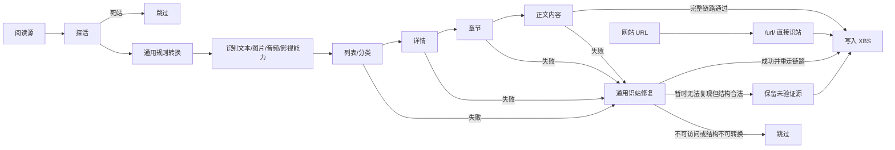

# read2xsgg

[](https://github.com/baixiaoshengofficial/read2xsgg/actions/workflows/test.yml)
[](https://hub.docker.com/r/knighttools/read2xsgg)

把「阅读 / Legado 3.x」的 JSON 书源转换成「香色闺阁」可导入的 `.xbs` 源，同时生成一份可审阅的香色 JSON 和兼容性报告。

## 功能

- 支持单个书源、书源数组，以及常见的 `sources` / `bookSources` 包装格式。
- 按阅读 `bookSourceType` 映射香色 `sourceType`：`0→text`、`1→audio`、`2→comic`、`4→video`；对历史源中误标为 `0` / `3` 的类型，会结合分组和正文能力推断小说、漫画、音频或视频，真正的文件下载源仍按 text 输出并告警。
- 转换搜索、详情、目录、正文和发现页规则；漫画正文由通用图片桥接提取，音频和视频正文由通用媒体桥接输出香色播放用的 `{url, httpHeaders, forbidCache}` JSON。
- 生成的选择器后处理统一使用香色 2.56.1 实测可执行的 `selector||@js:` 语法，不再输出会被当成普通选择器的单竖线 `selector|@js:`。
- 转换 XPath、JSONPath、阅读的 Jsoup 链式选择器、常见 CSS，以及 `{{@sel}}` / `{{Get('url')}}` 一类 Mustache 模板（登录分流回退为 `config.host`）。
- 转换 GET、POST、请求头、表单参数、关键字/页码模板和 GBK 编码配置。
- 原生生成 XXTEA 加密的 `.xbs`，不依赖外部转换程序。
- 对无法无损翻译的阅读 JS、`imageDecode`、登录 UI、递归 JSONPath、详情 `init` 等规则生成结构化告警。
- 输入既可以是本地文件、URL，也可以来自标准输入。
- 提供 HTTP 在线转换服务，香色闺阁可以直接订阅转换 URL。
- 提供 WebUI 源管理：异步完整抽测后生成稳定的 `/library/{id}.xbs` 订阅地址。
- 提供受 SSRF 防护的图片代理与可扩展解码器：普通图片直通，已内置猕猴桃漫画的 AES-CBC 图片解码。
- 为没有可移植发现页的源自动补充“站点首页”或“搜索入口”分类，避免源已导入但无法在香色的切换站点列表中选中。
- 提供 Docker Compose 一键部署、健康检查、缓存、并发控制和 SSRF 防护。

## 环境

需要 Node.js 18 或更高版本，无第三方运行时依赖。

```bash
npm test
npm link
```

也可以不安装，直接用 `node ./bin/read2xsgg.js`。

## Docker Compose 一键部署

先准备口令（可选但 WebUI 需要）：

```bash
cp .env.example .env
# 编辑 .env 中的 ADMIN_TOKEN
```

直接使用 Docker Hub 镜像：

```bash
docker compose pull
npm run deploy:local -- --pull always
```

镜像地址：`knighttools/read2xsgg:latest`。

如果希望从当前源码重新构建：

```bash
docker build -t knighttools/read2xsgg:local .
IMAGE_TAG=local docker compose up -d --pull never
```

默认监听 `http://localhost:3000`，检查服务状态：

```bash
curl http://localhost:3000/healthz
docker compose ps
```

停止服务：

```bash
docker compose down
```

修改宿主机端口：

```bash
APP_PORT=8080 docker compose up -d
```

指定版本镜像：

```bash
IMAGE_TAG=0.2.0 docker compose up -d
```

Compose 将项目中的 `./data` 绑定到容器 `/data`。镜像启动时会自动修复该目录的属主，再以非 root 的 `node` 用户运行服务；首次启动无需手工 `chown`。

## 本地发布到 Docker Hub

不再通过 GitHub Actions 推镜像（无需配置 `DOCKERHUB_TOKEN` secret）。本机登录 Docker Hub 后执行：

```bash
docker login
./scripts/docker-push.sh
```

默认推送：

- `knighttools/read2xsgg:latest`
- `knighttools/read2xsgg:sha-<commit>`
- 两个标签都包含 `linux/amd64` 和 `linux/arm64` 镜像清单

可覆盖镜像名 / 标签 / 平台：

```bash
IMAGE=knighttools/read2xsgg TAG=0.2.0 PLATFORM=linux/amd64 ./scripts/docker-push.sh
```

构建机需要代理或镜像源时，可通过 `BASE_IMAGE`、`BUILD_NETWORK`、`BUILDER` 覆盖构建参数；脚本会把已设置的 `http_proxy` / `https_proxy` 传给 BuildKit。

服务器部署时直接拉取：

```bash
docker compose pull
docker compose up -d
```

## 在线订阅（两种用法）

香色闺阁会检查链接是否以 `.xbs` 结尾。本站支持同步直转，也支持 WebUI 异步完整抽测后再订阅。

### 0. WebUI 异步源管理（推荐大聚合源）

大合集（几十上百个源）同步 `/source/` 会受抽测预算限制；WebUI 在后台做**完整抽测 + 识站回退**（默认不设任务总时间上限，但每源有独立验链预算），并实时显示进度与当前站点；完成后给出稳定订阅地址。

上千源的超大组合包可以完整抽测；每个源默认有 30 秒的完整验链预算，超出后取消该源的遗留请求并继续下一个源。可用 `JOB_VERIFY_SOURCE_BUDGET_MS` 调整单源预算，另可用 `JOB_VERIFY_BUDGET_MS` 设置整个任务的墙钟上限（两者为 `0` 时分别表示不限制）。

1. 复制环境变量并填写管理口令：

```bash
cp .env.example .env
# 编辑 .env：ADMIN_TOKEN=你的口令
docker compose up -d
```

`.env` 不会提交到 Git；Compose 会自动读取其中的 `ADMIN_TOKEN`。

2. 打开 `{本站}/ui/`，用同一口令登录后进入源管理，粘贴阅读源 JSON URL（或选「网站识站」）。
3. 等待任务变为 `done`，复制公开订阅地址：

```text
{本站}/library/{id}.xbs
```

管理 API（需 `Authorization: Bearer $ADMIN_TOKEN` 或 `X-Admin-Token`）：

- `POST /api/jobs` — `{ "url", "mode": "source"|"site", "name?" }`
- `GET /api/jobs` / `GET /api/jobs/:id`
- `POST /api/jobs/:id/retry`
- `POST /api/jobs/:id/publish` — 用显式声明式阅读源 JSON 覆盖同一 `id` 的 `/library/{id}.xbs`（`{ "source": <legado>, "verify?" }`，或直接提交 Legado 对象）；会持久化 payload，后续 retry 不再回落到缺字段的远程源
- `POST /api/jobs/:id/rebase` — 将制品内旧公开桥接 origin 替换为新 origin（`{ "oldOrigin"|"from", "newOrigin"|"to", "dryRun?" }`）；保留任务 id / 订阅路径 / source payload，只改属于旧 origin 的 URL；响应仅为摘要，不含制品正文
- `DELETE /api/jobs/:id`

AI 识站与 MCP 爬取可在 WebUI 的“AI 识站与 MCP 爬取”面板配置，也可经管理员 API 设置：

- `GET /api/settings/ai` — 只返回 AI/MCP 配置状态，不回显密钥
- `PUT /api/settings/ai` — 保存 `enabled`、`provider`（`api`、`local-http` 或 `cli`）、模型连接参数、`cliClient`、`mcpEndpoint`、`mcpToken` 和预算参数；密钥留空表示保留旧值，显式清除用 `clearApiKey` / `clearMcpToken`
- `POST /api/settings/ai/test`、`POST /api/settings/mcp/test` — 分别测试模型 API 和 MCP 工具发现

AI 可选三种接入：`api` 使用 OpenAI Chat Completions 兼容接口与 API Key；`local-http` 使用可从容器访问的本地 OpenAI 兼容 HTTP 服务，无需 API Key，在管理页填写 `localBaseUrl` 和 `localModel`；`cli` 通过宿主机桥接运行已登录的 Codex CLI。Compose 已解析 `host.docker.internal` 到宿主机网关；HTTP 服务仍需监听容器可访问的地址。三种模式互不转发已保存的云端 API Key。当前 CLI 白名单仅支持 `codex`，其他 CLI 需要增加适配器，而不是由网页输入任意命令。

CLI 模式需要在运行转换器的宿主机上以已登录 Codex 的用户启动桥接进程，且桥接进程与 Docker 的 `./data` 指向相同目录：

```sh
codex login status
npm run agent:bridge
```

桥接进程监听 `DATA_DIR/private-settings/agent.sock`（默认 `./data/private-settings/agent.sock`），仅允许目录所有者访问；容器使用已有的 `./data:/data` 卷连接 Socket，不挂载 Codex 登录文件。若在其他目录部署，启动桥接时设置与 Compose 卷一致的 `DATA_DIR`。若桥接由 root 启动，Socket 所有权自动匹配目录所有者。将桥接进程作为宿主机守护服务运行，并在管理页保存 `cli` 后点击“测试当前 AI 接入”。CLI 调用会限制输入/输出大小、并发和时长；客户端断开时会终止子进程。Codex 使用一次性会话、只读沙箱、独立临时工作目录和固定输出 schema；生成的规则仍要通过相同的安全校验和完整站点动作链实测。CLI 可能消耗账户额度；不可信网站内容即使脱敏也会发送给所选客户端，建议使用专用的低权限宿主机账户运行桥接进程。

MCP 使用 Streamable HTTP。MCP 地址可接浏览器/页面读取服务，未配置 MCP 时 AI 仅使用转换器抓取并脱敏后的页面证据。应用内置版本化的通用 `site-to-xiangse` 技能，按文本、漫画、音频、影视分别识别；不生成站点专属代码或 `@js`，并且只有香色 2.56.1 的列表/分类→详情→章节→正文完整动作链通过后才会收录 AI 候选规则。AI 默认关闭；触发模型调用会把受限大小、已脱敏的上游网页证据发送到所配置的 AI 服务，可能产生服务商费用。任务页分别显示实测通过、AI 修复、未验证保留、跳过数；仅实测通过数计入转换成功率。

API Key 与 MCP Token 保存在 `DATA_DIR/private-settings/ai.json`，目录/文件权限分别为 `0700` / `0600`，不会写入 `.env`、任务记录或 API 响应。AI 并发、单次预算、修正轮数和 MCP 只读工具调用数均可在 WebUI 调整；实际 MCP 服务器需自行提供可从容器访问的 Streamable HTTP 地址。

离线/运维也可：

```sh
npm run publish:library -- --id <jobId> --source path/to/legado.json --data-dir ./data

# 先 dry-run 校验，再写入（origins 来自配置，无硬编码域名）
npm run rebase:library -- --id <jobId> --from https://old-bridge.example --to https://new-bridge.example --dry-run
npm run rebase:library -- --id <jobId> --from https://old-bridge.example --to https://new-bridge.example --data-dir ./data
```

`rebase:library` / `POST .../rebase` 适用于公开转换站域名变更：在已有 JSON/XBS 上安全改写桥接基址，无需按源名或上游站点重转。`from === to` 或无匹配时为校验 no-op，不写盘。

制品落在 `DATA_DIR`（Compose 默认把项目目录的 `./data` 挂载到容器 `/data`）。未设置 `ADMIN_TOKEN` 时管理接口返回 503。

同步路径仍然可用；大聚合建议优先走 WebUI。

### 1. 网站识站 `/url/`

直接给小说站首页，自动探测列表/目录/正文并生成香色源：

```text
{转换站}/url/{去掉 https:// 后的网站主机}.xbs
```

例如网站是 `https://www.novel-site.example/`：

```text
https://xs.chenqinfeng.de/url/www.novel-site.example.xbs
```

### 2. 阅读源转换 `/source/`（同步直转）

给阅读（Legado）书源 JSON 地址，探活 → 转换 → 有限抽测（大源可能跳过/截断抽测预算）。适合少量源；**大聚合请用 WebUI**。

同步转换结果也会写入 `DATA_DIR/conversions`，因此服务或容器重启后可直接复用；有效期沿用 `CACHE_TTL_SECONDS`（默认 300 秒）。需要长期稳定且可管理的订阅请使用 WebUI 生成的 `/library/{id}.xbs`。

```text
{转换站}/source/{去掉 https:// 后的阅读源地址}.xbs
```

例如阅读源是：

```text
https://www.example.com/sources/all.json
```

对应订阅地址：

```text
https://xs.chenqinfeng.de/source/www.example.com/sources/all.json.xbs
```

单个书源示例：

```text
https://xs.chenqinfeng.de/source/www.example.com/sources/one.json.xbs
```

兼容别名（旧订阅可继续用）：`/xbs/...`、`/x.xbs?u=...`、`/convert.xbs?url=...`、`/analyze.xbs?url=...`。

查看转换后的 JSON 和兼容性告警：

```text
http://localhost:3000/j/www.example.com/legado.json
http://localhost:3000/convert/json?url=https://example.com/legado.json
```

可以直接运行 HTTP 服务而不使用 Docker：

```bash
npm start
# 或
node ./bin/server.js
```

### 漫画图片解码代理

香色不能执行阅读的 `java.createSymmetricCrypto` 或 Android 图像 API。服务提供图片代理，把解码放在 Node.js 侧：

```text
{转换站}/image?url=https://cdn.example.com/image.jpg
{转换站}/image/aes-cbc-prefix-iv-MDEyMzQ1Njc4OWFiY2RlZg?url=https://cdn.example.com/encrypted-image
{转换站}/image/md5-reverse-tiles-10-5?url=https://cdn.example.com/scrambled-image
```

`/image` 只直通 JPEG、PNG、GIF、WebP 等可识别图片；无法从图片字节推断算法。在线转换会分析阅读源 `imageDecode` 的规则形态：AES-CBC 前缀 IV 会提取 16/24/32 字节密钥；MD5 分块倒序会提取取模数和偏移量；书号/图片号分块只有在阈值、取模数和倍数全部提取成功后才生成参数化解码地址。不保留站点别名、固定密钥或固定默认参数。代理只返回验证过图片文件头的结果，且与在线转换一样禁止访问内网地址。

在线转换时，所有漫画正文都会使用规则驱动的通用桥接。转换器先把阅读 `ruleContent.content` 编译成一个不含可执行代码的提取计划，自动识别 JSON/JavaScript 属性（如 `imageUrl`、`pageSrc`、`url`）和 HTML 属性（如 `src`、`data-original`、`data-src`）；服务端再按该计划解析 HTML、JSON API、Next/React 分片脚本、`img/source` 标签或纯 URL 列表，最后返回香色原生的 `{urls:[...]}`。对于带 `page` / `pageIndex` 等查询参数的 JSON 漫画接口，还会自动识别 `current_page`、`total_pages`、`total`、`page_size` 及其驼峰别名，并发拉取、按页序去重合并全部图片。没有明确字段提示时，会自动发现包含图片 URL 的属性组并选择最可信的连续序列。原阅读源的 User-Agent、Referer、Cookie 等请求头会经过清理后随安全提取计划传给正文上游；Host、Content-Length 和连接级请求头不会透传。整个过程不使用站点域名作为判断条件，也不会执行阅读源携带的任意 JavaScript。

提取图片序列后，编译器会继续按 `imageDecode` 的算法能力选择参数化解码器。代理地址会从本次转换 URL 自动推导：优先使用 `Forwarded` 或 `X-Forwarded-Host` / `X-Forwarded-Proto`，公网域名默认使用 HTTPS；无需配置对外基础 URL。反向代理应保留 `Host`，并传递主机和协议头。

解码器按算法能力注册，而不是按网站注册。若以后出现当前能力集之外的全新加密或像素算法，只需新增一次该算法能力；采用相同算法的其他阅读源会从规则中自动识别并复用，不需要再增加域名或站点分支。登录态、验证码以及依赖完整 Android 环境的任意 JavaScript 仍无法安全地凭空执行。

### 音频与视频媒体桥接

音频和视频源与文本书源一样走完整核心链路（搜索 → 详情 → 目录 → 正文），不会因为类型是有声/视频就被质量门槛整类丢掉。转换器从 `ruleContent` 中编译安全的字段和 HTML 属性提示；若带有阅读 `sourceRegex`，会把其中的媒体扩展名（如 `.mp3`、`.m3u8`）编入提取计划的 `urlHints`。在线服务再从 JSON、HTML、脚本片段、`audio` / `video` / `source` / `iframe` 标签中寻找媒体地址，并优先命中这些扩展名提示，同时支持 HLS（`.m3u8`）和 DASH 分片。

播放地址经通用媒体适配器解析后，直接交给香色播放，并带上源站 `httpHeaders`（Referer / Cookie）。默认不再把音频塞进 `/media` 代理：代理会把 Referer 改成 CDN 域名，容易触发防盗链。`/media?url=` 仍保留给需要服务端转发的特殊场景。

若章节 URL 本身就是媒体地址则直接播放；若接口同时返回多个清晰度，会优先选择较高质量版本。转换器不会执行阅读源携带的远程 JavaScript、`eval` 或 Android 原生 API。

### 大型混合源验证

在线转换管线现在是：**探活 → 按阅读规则转换 → 识别类型 → 列表/分类 → 详情 → 章节 → 正文 → 写入 XBS**；任一动作失败都会继续通用识站修复并重走链路。失败本身不等于站点不可访问：只要源结构仍能生成合法 XBS，就保留为“未验证源”，供香色继续使用；只有探活确认不可访问，或最终无法生成合法 XBS，才跳过。



Compose **默认同步路径**开启 origin 探活、完整抽测与通用识站修复。站点可达时，转换器仍会执行“列表/分类 → 详情 → 章节 → 正文”的动作链；原规则失败就继续通用修复。若本次请求被限流、超时或返回临时空结果，但转换结果结构合法，则保留并标记为未验证，避免把阅读中可用的源误删。部署默认不设置同步抽测墙钟或源数量上限：

`PREFLIGHT_TIMEOUT_MS` 仅控制快速站点探活；完整列表、详情、章节与正文链路使用 `FETCH_TIMEOUT_MS`，不能用快速探活时限误判慢站。

- `PREFLIGHT_SOURCES=true`
- `VERIFY_CONVERTED_SOURCES=true`
- `ANALYZE_FALLBACK=true`（同步 `/source` 与 WebUI 任务都会识站修复）
- `RETAIN_UNVERIFIED_SOURCES=true`（结构合法但本次完整链路暂未复现时保留源；已确认不可访问或结构非法的源仍跳过）
- `VERIFY_BUDGET_MS=0` / `VERIFY_MAX_SOURCES=0`（仅同步 `/source`；`0` 表示完整执行，不因抽测预算主动截断）
- `JOB_VERIFY_BUDGET_MS=0`（WebUI 异步任务抽测墙钟预算；`0` 为完整抽测不限时）
- `VERIFY_SOURCE_BUDGET_MS=30000` / `JOB_VERIFY_SOURCE_BUDGET_MS=30000`（单源从原规则验链到列表、详情、章节、正文修复的墙钟预算；超时取消当前验链，结构合法的源保留为未验证并继续任务，`0` 明确表示不限）
- `JOB_VERIFY_WORKERS`（CPU 密集的规则解析/识站线程；显式值会限制在容器可用 CPU 并行数内、最高 16。网络探活并发独立由 `PREFLIGHT_CONCURRENCY` 控制）
- `JOB_ISOLATION=true`（WebUI 转换任务放入 Worker Thread，避免大聚合转换阻塞 3000 端口的健康检查和 API；仅调试注入假转换器时关闭）
- `PREFLIGHT_CONCURRENCY=8`（网络探活并发；完整验链由 `JOB_VERIFY_WORKERS` / `VERIFY_WORKERS` 按 CPU 拆分，同源识站结果仍会复用）
- `PREFLIGHT_RETRIES=3`（单个站点探活的总尝试次数；超时、TLS 断开或限流后会跳过该站点并继续任务）
- `PREFLIGHT_SOURCE_BUDGET_MS=30000`（单源探活总墙钟上限；限制多入口站点逐个超时造成的长尾）
- `ADMIN_TOKEN`（写在 `.env`，WebUI / `/api/jobs` 必需）
- `DATA_DIR=/data`
- `CACHE_TTL_SECONDS=300`（同步转换结果的内存与磁盘缓存有效期）
- `PREFLIGHT_DEEP_SOURCES=false`（全链路深检仍为 opt-in）

直接识站（不经过阅读源）：

```bash
# HTTP（推荐手拼）
curl -OJ "https://xs.chenqinfeng.de/url/www.novel-site.example.xbs"
# 兼容查询参数
curl "https://xs.example/analyze/json?url=https://www.novel-site.example/"

# CLI
npm run convert -- --analyze https://www.novel-site.example/ -o site.xbs --json site.json
```

阅读源本地转换若要启用抽测+回退：

```bash
npm run convert -- legado.json --verify --analyze-fallback -o sources.xbs --report report.json
```

识站会对首页做多类型信号检测；**每种能发现可用列表/目录/正文结构的类型各出一条源**（命名如 `站点·小说` / `站点·漫画` / `站点·听书` / `站点·影视`）。导出前会做两道校验：

1. **结构校验**：`sourceUrl` / `sourceType` / `miniAppVersion`、分类/搜索/详情/章节/正文必填字段、禁止单竖线 `|@js:`
2. **动作链实测**：按香色 2.56.1 的字段、`requestInfo`、列表项和正文请求语义跑通 分类列表 → 详情 → 章节 → 正文（漫画/音视频还会拉一条媒体 URL）。列表项标量字段及桥接模板字段统一使用香色可稳定执行的绝对后代 XPath（例如 `//@href`），避免仅在本地相对上下文模拟器中通过、导入香色后列表为空。

任一关失败则丢弃该类型，并在 JSON 的 `skippedKinds` 中说明原因。登录墙、强 JS 渲染站仍无法保证。

响应头 `X-Converted-Count` / `X-Skipped-Count` / `X-Skipped-Buckets` / `X-Fallback-Count` 便于观察：有多少是规则转换通过，有多少是识站回退。分桶包括 `dead-origin`、`core-chain`、`rules-stale`、`analyze-failed`、`imageDecode`、`login`、`media`。

本机 Docker 发布脚本默认先执行包括离线动作链在内的完整测试，测试失败不会构建或推送镜像。只有明确设置 `SKIP_VALIDATION=1` 才会跳过该门槛。

### 服务配置

Compose 支持通过环境变量调整：

| 变量 | 默认值 | 说明 |
| --- | ---: | --- |
| `APP_PORT` | `3000` | 映射到宿主机的端口 |
| `FETCH_TIMEOUT_MS` | `15000` | 下载在线阅读源的超时时间 |
| `MAX_SOURCE_BYTES` | `33554432` | 在线阅读源最大字节数（32 MiB，可容纳大型聚合源） |
| `MAX_IMAGE_BYTES` | `26214400` | 单张代理图片最大字节数 |
| `MAX_MEDIA_BYTES` | `83886080` | 单次 `/media` 代理最大字节数（约 80 MiB） |
| `INSECURE_MEDIA_HOSTS` | 空 | `/media` 允许跳过 TLS 校验的主机名列表（逗号/空格分隔）；必须显式配置 |
| `MAX_REDIRECTS` | `5` | 最大重定向次数 |
| `MAX_CONCURRENT` | `8` | 最大并发转换数 |
| `CACHE_TTL_SECONDS` | `300` | 内存缓存时间，设为 `0` 可关闭 |
| `MAX_CACHE_ENTRIES` | `100` | 最大缓存条目数 |
| `CORS_ORIGIN` | `*` | 允许的跨域来源 |
| `ALLOW_PRIVATE_NETWORKS` | `false` | 是否允许抓取本机或内网 URL |
| `ALLOW_DNS_PROXY_NETWORKS` | `true` | 允许域名经 Docker Desktop、Clash 等代理解析到 `198.18.0.0/15`；直接输入该网段 IP 仍会被拦截 |
| `PREFLIGHT_SOURCES` | `true` | 转换前探测上游站点是否可达（origin）；设为 `false` 可跳过探活以加快转换，但会死站也会进入 XBS |
| `PREFLIGHT_DEEP_SOURCES` | `false` | 实测分类列表、第一本书、章节和正文；仅在 `PREFLIGHT_SOURCES=true` 时生效。聚合源成本高，默认关闭 |
| `PREFLIGHT_TIMEOUT_MS` | `3000` | 单个上游站点预检/抽测超时时间 |
| `PREFLIGHT_CONFIRM_TIMEOUT_MS` | `10000` | 快速预检失败后，使用实际入口再次确认不可达的超时时间 |
| `PREFLIGHT_CONCURRENCY` | `8` | 上游站点并发预检/抽测数量；不建议在小内存容器中调高 |
| `VERIFY_CONVERTED_SOURCES` | `true` | 转换后完整抽测分类/搜索 → 详情 → 目录 → 正文；失败进入通用识站修复，结构合法但本次未复现的源保留 |
| `RETAIN_UNVERIFIED_SOURCES` | `true` | 完整动作链暂未复现时保留结构合法源；不可访问或结构非法的源仍跳过 |
| `ANALYZE_FALLBACK` | `true` | 抽测失败时用通用识站生成可用香色源；失败后按 `RETAIN_UNVERIFIED_SOURCES` 决定保留或过滤 |
| `ANALYZE_TIMEOUT_MS` | `8000` | 自动识站单次页面下载超时 |
| `VERIFY_WORKERS` | CPU 并行数（最多 8） | 同步路径 CPU 密集验链/识站的 Worker Thread 数；网络探活仍由 `PREFLIGHT_CONCURRENCY` 控制 |
| `VERIFY_SOURCE_BUDGET_MS` | `30000` | 同步路径单个源的完整验链/修复墙钟预算；超时取消当前验链，结构合法源保留为未验证，`0` 不限 |
| `VERIFY_BUDGET_MS` | `0` | 同步抽测墙钟上限（毫秒）；`0` 不限时，正数是显式的性能取舍，可能保留未抽测尾部 |
| `VERIFY_MAX_SOURCES` | `0` | 同步抽测源数量上限；`0` 不限，正数超过后跳过同步抽测 |
| `JOB_CONCURRENCY` | `1` | WebUI 异步转换并发任务数；每个任务独立 Worker Thread |
| `JOB_ISOLATION` | `true` | 是否把异步转换放到 Worker Thread，保护 HTTP 事件循环；生产环境保持开启 |
| `JOB_VERIFY_BUDGET_MS` | `0` | WebUI 异步抽测墙钟上限；`0` 不限时，正数是显式的性能取舍 |
| `JOB_VERIFY_SOURCE_BUDGET_MS` | `30000` | WebUI 单个源的完整验链/修复墙钟预算；超时取消该源并继续任务，`0` 不限 |
| `JOB_VERIFY_WORKERS` | 默认按 CPU 并行数，最多 8 | WebUI 验链/识站线程；显式值最多 16 且不会超过容器可用 CPU，网络探活并发另由 `PREFLIGHT_CONCURRENCY` 控制 |
| `MAX_COMIC_PAGES` | `50` | 单章 JSON 漫画接口最多聚合的分页数（含第一页） |
| `MAX_COMIC_IMAGES` | `2000` | 单章最多返回的图片数 |
| `COMIC_PAGE_CONCURRENCY` | `4` | 单章后续图片分页的并发请求数 |

服务默认禁止访问回环、内网、链路本地和保留地址，以降低公开部署时的 SSRF 风险。如果只在可信内网使用，并且阅读源本身位于局域网，可以这样开启：

```bash
ALLOW_PRIVATE_NETWORKS=true docker compose up -d
```

如果服务器没有使用虚拟 DNS/透明代理，并希望采用最严格的公网地址校验，可以关闭兼容开关：

```bash
ALLOW_DNS_PROXY_NETWORKS=false docker compose up -d
```

## 使用

```bash
read2xsgg legado.json \
  -o sources.xbs \
  --json sources.converted.json \
  --report sources.report.json
```

只查看转换后的 JSON：

```bash
read2xsgg legado.json --json-only > sources.json
```

从 URL 或管道读取：

```bash
read2xsgg https://example.com/legado.json -o sources.xbs
curl -s https://example.com/legado.json | read2xsgg - --json-only > sources.json
```

在代码中调用：

```js
import { convertLegado, encodeXbs } from "read2xsgg";

const { sources, warnings } = convertLegado(legadoJson);
const xbs = encodeXbs(sources);
```

## 转换范围与限制

两款应用的规则引擎并不相同，因此转换器采取“能确定语义就转换，不能确定就保留并告警”的策略。

可以自动转换的主要内容：

| 阅读 | 香色闺阁 |
| --- | --- |
| `searchUrl` | `searchBook.requestInfo` |
| `ruleSearch` | `searchBook` |
| `ruleBookInfo` | `bookDetail` |
| `ruleToc` | `chapterList` |
| `ruleContent` | `chapterContent` |
| `exploreUrl` + `ruleExplore` | `bookWorld` |
| `{{key}}` / `{{page}}` | `%@keyWord` / `%@pageIndex` |
| Jsoup/CSS/JSONPath | XPath/香色 JSON 路径 |

以下内容需要重点查看 `--report` 生成的报告：

- `@js:`、`<js>` 规则：两边的全局变量和原生 API 不同，代码会保留，但通常需要手工适配。
- `$..field` 递归 JSONPath：香色没有完全等价的递归下降表达式，会退化为普通路径。
- `ruleBookInfo.init`：香色没有直接对应字段。
- 登录、验证码、WebView 注入、加密签名等依赖阅读运行时的高级行为。
- 已下线、拒绝当前服务器访问或必须登录才能读取的上游站点；转换器不会用站点专用逻辑伪造可用结果。

建议第一次转换时始终同时生成 JSON 和报告，先在香色闺阁中导入少量源测试搜索、详情、目录、正文四个环节，再批量导入。

## XBS 兼容性

`.xbs` 的编码/解码实现与开源项目 [xbsrebuild](https://github.com/ne1llee/xbsrebuild) 的格式兼容。测试覆盖了加解密往返；项目本身不会联网提交或执行书源中的脚本。

规则字段同时经过本项目动作链验收器和独立的香色 2.56.1 HTTP 规则模拟器验证。生成器只发布 `||@js:` 后处理形式；单竖线 `|@js:` 即使能在部分资料中看到，也不会作为转换结果输出。真实 App 的 WebView、登录态和系统网络环境仍可能与 HTTP 模拟器不同，遇到这类源会在预检或兼容性报告中明确跳过/告警，而不是把它标成已验证可用。
